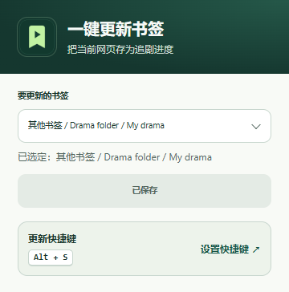

# Quick Bookmark Updater

[简体中文](README.md) · English

Save the current page's URL to a selected Chrome bookmark with a keyboard shortcut. Pick a bookmark for the show you're watching, press **Alt + S** on the episode page, and use the same bookmark to return next time. The extension changes only the URL and preserves the bookmark's name, folder, and position.

## Install from source

1. Download or clone this repository. If you downloaded a ZIP, extract it first.
2. Open `chrome://extensions` in Chrome and turn on **Developer mode** in the upper-right corner.
3. Click **Load unpacked** and select the folder containing `manifest.json`.
4. Open the extension from Chrome's Extensions menu. Pin it to the toolbar for easy access to its status badge.

The extension interface is currently in Simplified Chinese.

## Use

1. Open the popup, select an existing bookmark, and click **保存选择** (Save selection). If you don't have a bookmark yet, create one in Chrome first.
2. Open the HTTP or HTTPS page you want to keep and press **Alt + S**.
3. When the extension icon shows **OK**, the original bookmark will take you to the new URL.

When the popup opens, it preselects a bookmark whose URL exactly matches the current page. If multiple bookmarks match, it prefers the one opened most recently. If the matching bookmarks have tied or missing last-opened times, choose from the list. Click **保存选择** to change which bookmark the shortcut updates.

## Troubleshooting

| What you see | What to do |
| --- | --- |
| The shortcut doesn't respond | Click **设置快捷键** (Configure shortcut) in the popup or open `chrome://extensions/shortcuts`. Confirm the binding and check for conflicts. |
| The icon shows `ERR` | Hover over the icon for details. Make sure the current tab is a regular web page and the selected bookmark still exists. |
| A bookmark isn't preselected | Matching uses the exact current URL. If the site redirects to a different URL, select the original bookmark manually. |

## Permissions and data

| Permission | Purpose |
| --- | --- |
| `bookmarks` | List existing bookmarks and update the selected bookmark's URL. |
| `activeTab` | Read the current tab's URL when you open the popup or invoke the shortcut. |
| `storage` | Remember the selected bookmark ID in the current Chrome profile. |

The extension processes data in the browser. It doesn't send bookmarks, page URLs, or usage data to the developer or to third-party servers.

## Development

The extension uses Chrome Manifest V3 and vanilla JavaScript. Load it directly from source without installing dependencies or running a build. After editing, click **Reload** for the extension on `chrome://extensions`. Use a temporary bookmark to check automatic selection, saving, and the update shortcut.

## License

[MIT](LICENSE)
